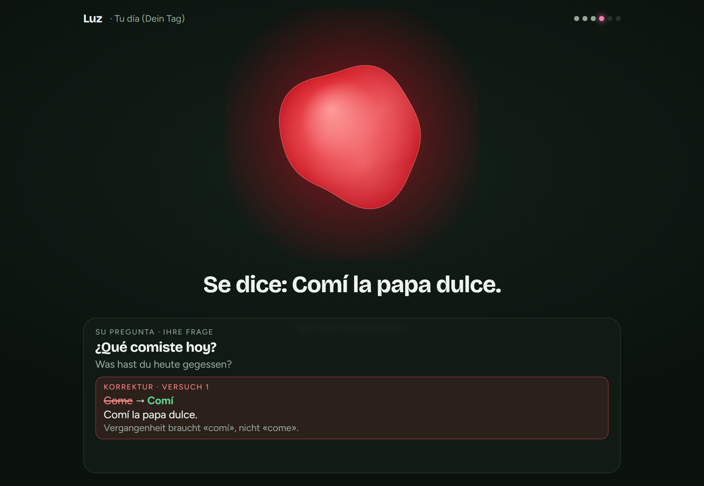
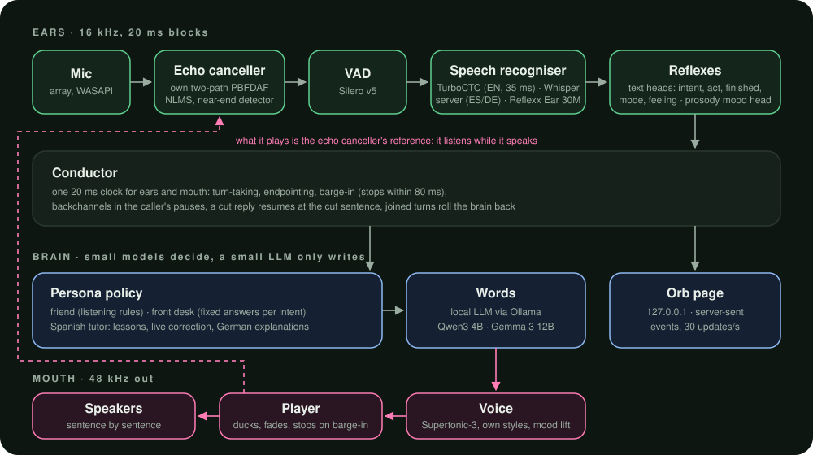
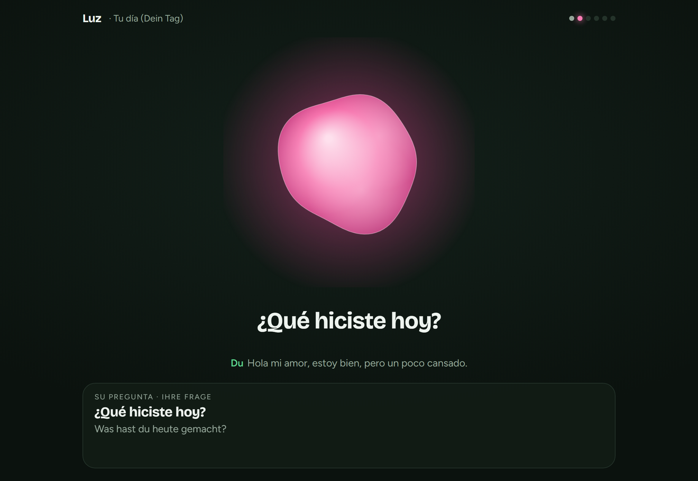
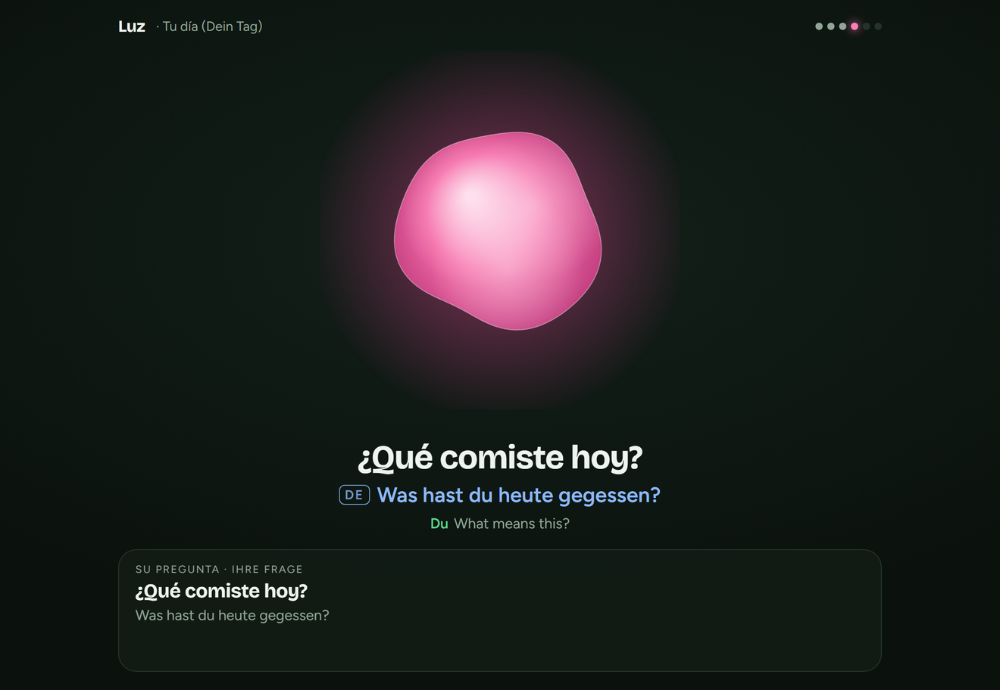
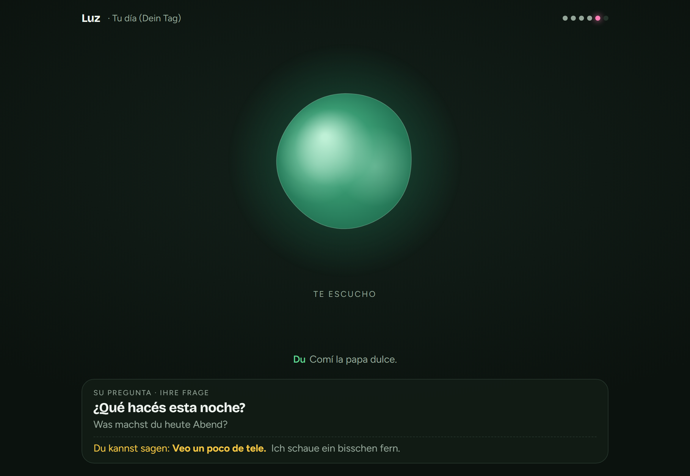
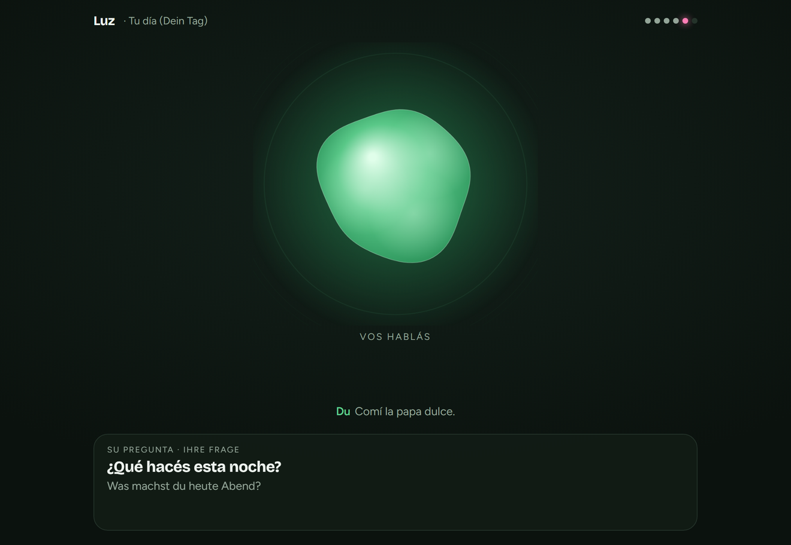

# DUET

**A full-duplex voice agent built from small models, running entirely on one laptop.** It listens while it speaks,
lets you interrupt it, murmurs "mm-hm" in your pauses, reads your mood from the tone of your voice, and answers in
about a third of a second. No cloud: echo cancellation, speech recognition, the decisions, the words and the voice
all run locally (Windows, Python + ONNX Runtime, a laptop Radeon).

<p align="center"></p>

<p align="center"><sub>Luz, the Spanish-tutor persona, correcting a learner's real answer from a live call.
The orb is her voice; it turns red while she corrects and asks the question again.</sub></p>

## Why it's built this way

Big speech-to-speech models are one network that does everything, slowly and in the cloud. DUET is the opposite
bet: **many miniature models, each making one decision in milliseconds**, and a small language model that only
writes the words once the decisions are made. It came out of our work on Reflexx (a 13.5 ms intent router for phone
calls) and on our own voices.

- **It hears itself.** Its own echo canceller (two-path PBFDAF NLMS with a near-end detector) gets the exact signal
  it plays as the reference, so it can keep listening while it talks. A voice over its own stops it within 80 ms;
  a "mm-hm" over its reply doesn't.
- **It decides before it writes.** Text heads on a small encoder read the intent, the dialogue act, whether the
  sentence is finished, what the caller wants now and how strong the feeling is. A prosody head reads arousal from
  pitch and energy, measured against the caller's own usual level.
- **It sounds like it's listening.** Backchannels in the caller's pauses (timed on pitch cues from the
  conversation-analysis literature), replies that start with a pre-rendered opener the moment the turn ends, the
  language model continuing that opener instead of repeating it, and a cut-off reply resuming at the sentence where
  it was cut.

<p align="center"></p>

## Measured

| What | Result |
|---|---|
| Reply latency, caller stops → first sound (English, simulated laptop with room echo) | **288–352 ms** |
| Barge-in: our audio stops after a real interruption | **≤ 80 ms** |
| Intent on 310 recorded test calls (text / through phone-line ASR) | **91.6 % / 90.6 %** (bge-base baseline 88.4 %) |
| Dialogue acts on unseen phrasings | **91 %** |
| Arousal from tone on unseen speakers (CREMA-D) | **78 %, AUC 0.86** |
| What the caller wants (friend mode head, 68 hand-labelled lines) | **91 %** (rules: 75 %) |
| First token of the words (Qwen3 4B, Ollama, Radeon 8060S) | **62–77 ms**, ~57 tokens/s |
| Spanish turns heard by a resident Whisper large-v3-turbo on the GPU | **~0.7 s** a turn (a new process per turn: 1.4–1.9 s) |

Every number has its run in [docs/DETAILS.md](docs/DETAILS.md).

## Personas

- **The friend** (`duet/friend.py`): a good listener, built on 27 rules from the research on active listening
  ([docs/research-good-listener.md](docs/research-good-listener.md)). It matches your energy, is glad with you about
  good news, stays serious with bad news, and only gives advice when asked.
- **The front desk** (`duet/replies.py`): a receptionist for our studio. The small models pick the answer, nothing is
  generated, so it can't invent a price or a promise.
- **The Spanish tutor** (`duet/amiga.py`, `duet/lessons.py`): two Paraguayan conversation partners for a German
  learner, Luz and Sofía. They speak A1-level Spanish with vos, walk the learner through conversation lessons one
  question at a time, check every answer, and correct it the way a good teacher does: red orb, the corrected
  sentence, the rule in German, the same question again. "What means this?" gets a German explanation in a German
  voice; "Wie sage ich ...?" gets the Spanish and "Decilo vos." It was shaped by real calls: the learner's own
  mistakes and questions, transcribed and analysed ([docs/amiga-teacher.md](docs/amiga-teacher.md)).

| | |
|:---:|:---:|
|  |  |
| she asks the next question | "What means this?": the meaning in German |
|  |  |
| listening: an answer to borrow fades in | the learner speaking |

The orb page (`duet/orb.py`, `duet/web/orb.html`) is served on 127.0.0.1 and fed by server-sent events: the
conductor's state 30 times a second, her output level, the sentence she is saying, what was heard, the lesson.

## Reflexx Ear: our own small speech recogniser

DUET's English recogniser is IBM's Granite TurboCTC (470M). In parallel we train our own: a **30M-parameter causal
"ear"** (gated-delta + windowed-attention blocks from our KARST architecture work, 16k-piece CTC, 160 ms lookahead),
distilled from a teacher on 3,000+ hours of audiobooks, parliament speech and TTS conversations through a simulated
phone line ([docs/reflexx-ear.md](docs/reflexx-ear.md), code in `ear/`).

| | WER |
|---|---|
| held-out audiobooks (clean / other), greedy | 13.0 % / 15.8 % |
| with our own 4-gram LM in a CTC prefix beam | 10.6 % (audiobooks), 14.6 % (clean calls) |
| int4 body + int8 head | 19.9 MB, +1–3 points |
| **a real human voice on a laptop mic** | **43 %**: the open problem, documented rung by rung |

That last line is why DUET still ships TurboCTC: synthetic voices aren't human voices, and the log shows exactly
how far each fix moved it.

## Run it

Windows, Python 3.13, a microphone and speakers (a headset is cleanest), and [Ollama](https://ollama.com) for the
words. The models are not in this repository (`models/`, ~2 GB): Granite TurboCTC (Apache-2.0), Silero VAD v5 (MIT),
Supertonic-3 (OpenRAIL-M) with its preset voices (our own designed voices are private), bge-small-en-v1.5 (MIT), and
the heads trained here (`tools/train_text_reflex.py`, `tools/train_prosody_head.py`).

```
py -3.13 -m venv .venv
.venv/Scripts/python -m pip install -r requirements.txt
ollama pull qwen3:4b-instruct-2507-q4_K_M
.venv/Scripts/python -m duet sim front-desk        # a scripted caller on a simulated laptop, no microphone
.venv/Scripts/python -m duet text                  # type to the friend and see every decision
.venv/Scripts/python -m duet live                  # talk
.venv/Scripts/python -m duet live --persona novia  # the Spanish tutor, with the orb page
```

The Spanish tutor also needs ffmpeg 8.1+ (its whisper filter) with `ggml-large-v3-turbo-q5_0.bin`, and works best
with Gemma 3 12B in Ollama. The learner's name and facts go in `data/amiga/about.json` (not in git).

## Repository

| | |
|---|---|
| `duet/duplex.py` | the conductor: one 20 ms clock, turn-taking, barge-in, backchannels |
| `duet/aec.py`, `vad.py`, `asr.py`, `spanish_ears.py` | ears: echo canceller, voice activity, recognisers |
| `duet/understand.py`, `prosody.py`, `mood.py` | reflexes: text heads, tone, mood → voice |
| `duet/friend.py`, `brain.py`, `amiga.py`, `lessons.py` | the personas |
| `duet/voice.py`, `llm.py` | mouth: Supertonic-3 voice with mood lift, the local language model |
| `duet/sim.py` | a virtual laptop: room echo, noise, scripted callers on a real 20 ms clock |
| `ear/` | Reflexx Ear: data, training, CTC decoding, LM, quantisation |
| `tests/` | echo canceller, turn-taking policy, friend, Spanish tutor |
| `docs/` | the full manual, the ear's research log, the listening research, the tutor case study |

## License

Code: [Functional Source License 1.1, ALv2 Future License](LICENSE) (FSL-1.1-ALv2), a "Fair Source" licence: the
source is public, but it is not OSI-approved open source. You may read, use, modify and self-host DUET for any purpose
except offering a competing commercial product or service. Each version becomes Apache 2.0 two years after its
release. The models keep their own licences (Supertonic-3's OpenRAIL-M forbids impersonating real people); see
[NOTICE](NOTICE).

Built by [GRAPHIQ Studio](https://graphiq.art).
